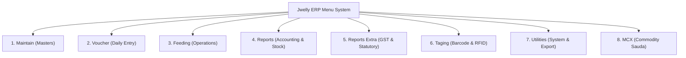
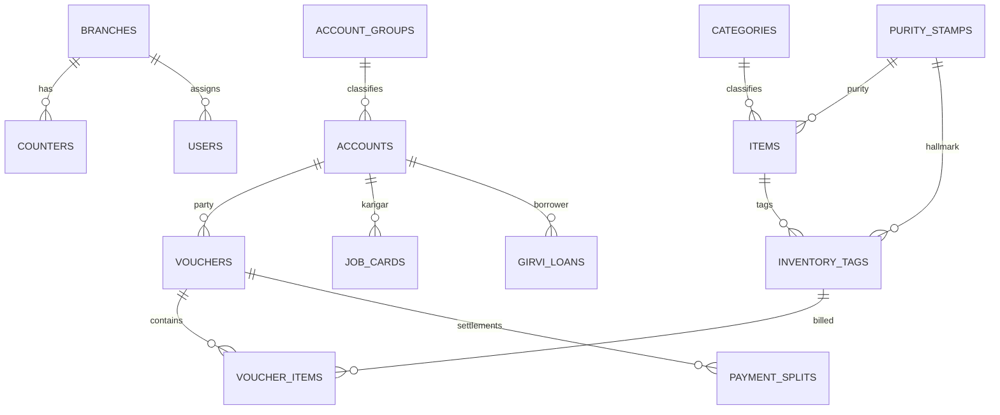

# Rudra Silver - Master Jewellery ERP Specification
## Complete Architecture & Domain Blueprint for Modernization with React & MySQL
### Based on MMI Jwelly ERP (JWERP) Legacy System Analysis & Production UI

---

## 1. Executive Overview & System Identity

* **Original System**: MMI Jwelly ERP (`jwelly9.exe`) - Rudra Silver Ornaments (Company ID: `1001`, Software ID: `JE19789`).
* **Target Modern Architecture**:
  * **Frontend**: React 19 + TypeScript + Vite + Tailwind CSS + Web Serial API (Electronic Weighing Scale integration) + Full Keyboard Shortcut Engine.
  * **Backend**: Python 3.13 (FastAPI + SQLAlchemy 2.0 + Pydantic v2) with Decimal precision math engine.
  * **Database**: MySQL 8.0+ (InnoDB, utf8mb4) with native triggers and stored procedures for automated multi-balance ledger maintenance.

---

## 2. Production UI & Screen Mapping

The system has been modernized with the **Rudra Silver Luxury Obsidian & Gold Theme** (`#080a0d`, `#d4af37`), featuring a responsive layout with a top navigation bar, collapsible sidebar, and luxury dashboard cards:

```
+-----------------------------------------------------------------------------------------------------------------------------------------+
| [💎] RUDRA SILVER (Pure Silver • Pure Elegance)     [Dashboard] [Billing] [Inventory] [Reports] [Settings]       [Scale] [🔔 3] [ (A) Admin v ] |
+-----------------------------------------------------------------------------------------------------------------------------------------+
| [🏠 Dashboard     ] |  ⚠️ Demo Mode: All data shown is sample data for UI development. Connect backend API for live data.                       |
| [📄 New Billing   ] | +----------------------------+ +----------------------+ +-------------------------------------------------------+ |
| [⚖️ Silver Weighing] | | RUDRA SILVER               | | [₹] ₹48,750   ↑ 12%  | | [📊] Sales Overview          [Today] [7 Days] [30 Days]   | |
| [✨ Item Master    ] | | Premium Silver Jewellery   | | Today's Sales        | |  40k|                        .-*                          | |
| [📈 Silver Rate    ] | | Elegance in Every Detail   | | [📄] 28        ↑ 8%  | |  30k|                    .--'                             | |
| [👥 Customers      ] | | [View Collection ->]       | | Total Invoices       | |  20k|                .--'                                 | |
| [📦 Inventory      ] | |                            | | [⚖️] 320.50g   ↑ 15% | |  10k|          .----'                                     | |
| [🕒 Invoice History] | | (Silver Bracelet Showcase) | | Silver Sold          | |    0+----*----+----+----+----+----+------------------------+ |
| [📊 Reports        ] | | (● ○ ○)                    | | [📈] ₹150/g  Silver  | |        9AM   11AM  1PM  3PM  5PM  7PM                     | |
| [📶 Scale Connect  ] | +----------------------------+ +----------------------+ +-------------------------------------------------------+ |
| [🖨️ Printer Set.   ] | +----------------------------------------------------+ +-------------------------------------------------------+ |
| [🛡️ User Mgmt.     ] | | [✨] Jewellery Categories                          | | [📦] Inventory Summary                                | |
| [⚙️ Settings       ] | | [Payal >] [Chain >] [Kada >] [Ring >] [Brac.] [Oth.]| |   ( Donut Chart: 78% )   ● Total Stock: 12.5 kg       | |
|                      | +----------------------------------------------------+ |   ( Stock Healthy    )   ● Available:    9.8 kg       | |
|                      | +----------------------------------------------------+ |                          ● Low Stock:    2.7 kg       | |
|                      | | [📄] Recent Invoices               [View All ->]   | +-------------------------------------------------------+ |
|                      | | # INV-1001 Neha Patel   02:45 PM  ₹8,497   [Paid]  | +-----------------------+ +-----------------------------+ |
|                      | | # INV-1000 Rahul Sharma 01:30 PM  ₹12,450  [Paid]  | | [⚡] Quick Actions     | | Rudra Silver                | |
| (Rudra Silver)       | | # INV-0999 Priya Shah   12:15 PM  ₹6,230   [Paid]  | | [⚖️ Weigh] [📄 New Inv] | | Where Purity Meets Luxury   | |
| (Shine Forever...)   | | # INV-0998 Amit Desai   11:50 AM  ₹9,120   [Pend]  | | [📦 Add]   [📊 Reports]| | (Diamond Ring Showcase)     | |
| (Silver Ribbon ~~~)  | +----------------------------------------------------+ +-----------------------+ +-----------------------------+ |
+-----------------------------------------------------------------------------------------------------------------------------------------+
```

### 2.1 The Central Daily Entry Hub (Voucher Shortcuts)
The primary screen allows instant voucher entry using single-key shortcuts:
* `1` : **Receipt** (Cash / Bank receipt from party)
* `2` : **Payment** (Cash / Bank payment to supplier/karigar)
* `3` : **Sale** (Retail / Wholesale jewellery tax invoice)
* `4` : **Purchase** (New stock or raw metal purchase)
* `5` : **Sale Return** (Customer returns / Credit notes)
* `6` : **Pur. Return** (Stock return to supplier / Debit notes)
* `7` : **Journal** (General adjustment voucher)
* `8` : **Contra** (Cash deposit / withdrawal from bank)
* `9` : **Issue** (Approval issue to customer / Metal issue to Karigar)
* `0` : **Receive** (Approval return / Finished goods receipt from Karigar)
* `+` : **Order** (Customer custom order / advance booking)
* `-` : **Repair** (Customer ornament repair / polish / stone replacement)

### 2.2 Right Action Bar (Direct Transaction Modules A-G)
* `A` : **Cash** (Quick Cash Sale / Counter Sale)
* `B` : **Stk. Journal** (Stock Journal / Metal conversion / Category shift)
* `C` : **Quotation** (Customer estimation / quotation slip)
* `D` : **Credit Note** (Financial or metal credit note)
* `E` : **Voucher** (Advanced multi-leg journal / payment entry)
* `F` : **Job Order** (Karigar manufacturing job card generation)
* `G` : **EXPENSE** (Direct shop / operational expenses entry)

### 2.3 Quick Report Function Keys (F1-F9 & Ctrl Shortcuts)
* `F1` : **Ledger Short** (Party account statement preview)
* `F2` : **Metal Stock** (Live stock balance: Gross wt, Net wt, Fine Silver & Gold)
* `F3` : **Daily Balance** (Daily party closing balances)
* `F4` : **Age Wise** (Accounts aging / receivables aging)
* `F5` : **Daily Transaction** (Complete transaction list for the day)
* `F6` : **Cash Book** (Daily cash in / out ledger)
* `F7` : **Silver Bullion** (Bullion position, sauda balance, and unhedged silver)
* `F9` : **Stock** (Item-wise tagged & loose physical stock)
* `Ctrl+A` : **Sale Register** (Date-wise / bill-wise sales register)
* `Ctrl+B` : **Purchase Register** (Date-wise / party-wise purchase register)
* `Ctrl+C` : **Profit Customer Wise** (Gross profit breakdown per customer)
* `Ctrl+D` : **Sale Detailed** (Itemized sale register with gross/net/labour breakdown)
* `Ctrl+E` : **Purchase Detailed** (Itemized purchase register with metal weights)

---

## 3. Comprehensive Master Menu Hierarchy (All 918 System Options)

The ERP is categorized into 8 top-level modules plus the MCX trading engine:



---

### Module 1: Maintain (Masters & Configuration - 275 items)

* **Accounts (`\Accounts`)**:
  * Add, Modify, Delete, List
  * Party Rates (Party Wise, Item Group Wise, Item Wise, Stamp Wise, Diamond/Stone Stamp Rates)
  * Account Merge
* **Sub Accounts (`Sub Accounts`)**: Add, Modify, Delete, Merge
* **Account Group (`A/c Group`)**: Add, Modify, Delete (Capital, Current Assets, Debtors, Creditors, Karigar, Cash, Bank, Loans)
* **Item Master (`\Item`)**:
  * Add, Modify, Delete, List, Item Merge
  * Remarks Master, ReOrder Level
  * Group Code (Add, Modify, Delete)
  * Category (Add, Modify, Delete - Payal, Kandora, Kada, Bangles, Chains, Utensils)
  * Labour/Wastage General Setup
  * Quality Master, Size Master
* **Item Group (`Item Group`)**: Add, Modify, Delete
* **Stamp / Purity (`\Stamp`)**:
  * Add, Modify, Delete, List
  * Pure Silver 99.9%, Sterling 92.5%, 80% Silver, 70% Silver, Gold 24K, 22K 916, 18K 750
* **Diamond & Stone Setup (`\Dia/Stone Setup`)**:
  * Clarity (IF, VVS1, VVS2, VS1, VS2, SI1, SI2, I1)
  * Shape (Round, Princess, Marquise, Oval, Pear, Heart, Baguette)
  * Size / Sieve Matrix, Rapaport Price Rate Sheet
* **Opening Stock (`\Opening Stock`)**:
  * Loose Jewellery, Metal (Gold/Silver bar), Dia/Stone Loose
  * Tagged Items (One Item, Multiple Items)
  * Stock on Approval (Account Wise, Job No. Wise)
* **Series Setup (`Series`)**:
  * Sale, Purchase, Sale Return, Purchase Return, Opening Balance, Order, Repair, Kitty, Payment, Receipt, Contra, Journal, Item Issue, Item Receive
* **Bill Sundry (`Bill Sundry`)**: Sale, Purchase, Item Issue, Item Receive, Order (Discounts, Extra Labour, Roundoff, Courier, Insurance)
* **Company & Branch Setup (`Company Detail`, `Branch`, `Site`)**:
  * Branch Configuration, Bill Print Setup, SMS Gateway Config, Paths Setup
* **Manufacturing Setup (`\Manufacturing Setup`)**:
  * Job Creation (Melting, Casting, Handcrafting, Setting, Polishing)
  * Department Creation, Labour/Wastage Rules, Melting Touch Range, Lot ID List
* **Girvi Setup (`\Girvi`)**:
  * Girvi Account, Village Master, Pledged Item Master, Piece Details, Interest Slab Setup
* **Customer Database (`Customer Database`)**: Add, Modify, Delete, KYC, DOB, Anniversary
* **Staff & Payroll (`Salary`)**: Employee Master, Salary Heads, Attendance Rules
* **Multi-Currency (`Currency`)**: Currency Master, Exchange Rates

---

### Module 2: Voucher (Daily Entry & Transactions)
The core transaction engine controlling:
* Cash Sale, Tax Invoice (B2B / B2C), Old Metal Exchange
* Purchases (Bullion, Finished Stock, Scrap Metal)
* Approvals / Jangad (Issue on Approval, Return, Convert to Invoice)
* Financial Vouchers (Receipt, Payment, Contra, Journal)
* Metal Vouchers (Metal Receipt, Metal Payment, Bhav Cut)

---

### Module 3: Feeding (Daily Operational Entries - 46 items)

* **Daily Bhav (`Daily Bhav`)**: Daily Gold & Silver Buying and Selling Board Rates
* **Sauda Book (`Sauda Book`)**: Forward bullion booking, margin calculation
* **Catalogue & E-Catalog (`Catalogue`, `E Catlog`, `Catalogue Group`)**: Visual jewellery product catalog
* **Naam Jama (`Naam Jama`)**: Traditional Indian accounting Debit/Credit slip entry
* **Daily In/Out (`Daily In/Out`)**: Staff and metal movement registry
* **Staff Attendance (`Attendance`)**: Daily employee check-in/out and working hours
* **Tunch Testing (`Tunch`)**: Fire assay / XRF purity testing record
* **Bank Reconciliation (`Bank Reconciliation`)**: Cheque clearing, ICICI Bank API integration
* **Box Tag Movement (`Box Tag In`, `Box Tag Out`)**: Tray and safe box transfer
* **Badla Register (`Badla Register`)**: Interest and rate spread ledger
* **Task & Reminders (`TO Do Task`, `Reminder`, `Work Book`)**: Daily operational reminders
* **Web Order Register (`Web Order Register`)**: Orders synchronized from e-commerce / mobile apps

---

### Module 4: Reports (Accounting, Stock & Registers - 265 items)

* **Ledger Reports**: Short Ledger, Detailed Ledger, Bill-Wise Ledger, Sub-Account Ledger
* **Outstanding Reports**: Daily Balance Sheet, Outstanding Summary, Bill-Wise Outstanding, Age-Wise Outstanding
* **Daily Books**: Daily Transaction Sheet, Cash Book, Gold Book, Silver Book, Day Book, Silver Bullion Ledger
* **Stock Status**: Loose Stock, Tagged Stock, Stamp-Wise Stock, Category-Wise Stock, Approval Stock
* **Stock Summary**: Tagged Summary, Complete Summary, Item Ledger, Stock List
* **Sale Registers**: Bill-Wise, Detailed, Item-Wise, Stamp-Wise, Party-Wise, Date-Wise, Monthly
* **Purchase Registers**: Bill-Wise, Detailed, Item-Wise, Stamp-Wise, Party-Wise, Date-Wise, Monthly
* **Karigar Registers**: Karigar Issue Register, Karigar Receive Register, Setting Register, Job Register
* **Administrative Reports**: Trial Balance, Weight Trial (Fine Gold/Silver trial), Trading & P&L, Balance Sheet, Gross Profit Summary, Customer-Wise Profit, Monthly Expenses
* **Girvi Reports**: Active Loan Ledger, Monthly Interest Register, Overdue Notices, Auction Register
* **Kitty Reports**: Swarna Nidhi Member Passbook, Installment Due List, Matured Accounts
* **Bullion Reports**: Bullion Sauda Register, Unsettled Positions, Badla Report

---

### Module 5: Reports Extra (GST & Statutory - 242 items)

* **GST Registers**:
  * GSTR-1 Sales Report (B2B, B2CL, B2CS, Credit Notes)
  * GSTR-3B Summary
  * HSN Summary Report (HSN 7113 for jewellery)
  * E-Way Bill & E-Invoice Generation Register
* **Statutory Registers**: TCS (Tax Collected at Source) on cash sales above ₹2 Lakhs, PAN verification register.

---

### Module 6: Taging (Barcode & RFID Stock Management - 33 items)

* **Tag Generation**: Single Item Tag Generation (`Gen. One Item`), Bulk Batch Tag Generation (`Gen. Multiple Item`)
* **Tag Printing**: Barcode Label Printing, RFID Tag Encoding
* **Stock Audits**:
  * Physical Stock Verification (`Physical Stock` / `Feed RFID No`)
  * Age-Wise Stock, Quality Weight-Wise Stock, Weight Range Stock
* **Tag Modification & Inquiry**: Tag Query, Tag Profit Analysis, Re-Order Level Alert, Tag History

---

### Module 7: Utilities (Maintenance & Data Sync - 47 items)

* **Data Synchronization**: Tally Prime Export (`Tally Export`), Web Catalog Export (`Web Export`), Mobile App Transfer
* **Financial Year Operations**: Freeze Date (Freeze past transactions), Year-End Closing (`Close Year/Refresh`), Renumbering Vouchers
* **Backup & Integrity**: Backup & Restore Database, Compare Data, Stream Line
* **Utilities**: Interest Calculator (`Int Calculator`), Hisab Final (Daily cash & metal tally)

---

### Module 8: MCX (Commodity Trading Engine - 8 items)

* MCX Sauda Booking (`Sauda`)
* Open Position Clearing (`Open Clearing`, `Clearing`)
* Party Sauda Register (`Party Sauda`)
* MCX Hisab Sheet (`Hisab Print`, `Standings`)

---

## 4. Fundamental Business Logic & Mathematical Formulas

### 4.1 Triple-Currency Account Ledger

Every account in the system maintains three concurrent balances:

$$\text{Account Balance} = \langle \text{Balance}_{\text{INR}}, \text{Balance}_{\text{FineGold (g)}}, \text{Balance}_{\text{FineSilver (g)}} \rangle$$

* **Metal Debit/Credit**: When goods are delivered or received on weight terms, fine grams are adjusted directly without cash valuation.
* **Bhav Cut**: When a party fixes their metal rate, the weight is converted to currency:
  $$\Delta \text{Balance}_{\text{INR}} = \Delta \text{Weight}_{\text{Fine}} \times \text{Agreed Rate}$$
  $$\Delta \text{Balance}_{\text{Fine}} = -\Delta \text{Weight}_{\text{Fine}}$$

---

### 4.2 Jewellery Line-Item Math

$$\text{Net Weight} = \text{Gross Weight} - \text{Less Weight (Stones + Enamel + Wax + Thread)}$$

$$\text{Effective Purity (\%)} = \text{Touch Purity (\%)} + \text{Wastage (\% (WSTG))}$$

$$\text{Fine Metal Weight (g)} = \frac{\text{Net Weight} \times \text{Effective Purity}}{100}$$

$$\text{Metal Amount (₹)} = \text{Fine Metal Weight} \times \text{Pure Metal Rate per gram}$$
$$\text{OR}$$
$$\text{Metal Amount (₹)} = \text{Net Weight} \times \text{Ornament Rate per gram}$$

$$\text{Labour (Making Charges)} = 
\begin{cases} 
\text{Net Weight} \times \text{Rate per gram} & (\text{PER\_GRAM\_NET}) \\
\text{Gross Weight} \times \text{Rate per gram} & (\text{PER\_GRAM\_GROSS}) \\
\text{Pieces} \times \text{Flat Rate} & (\text{PER\_PIECE}) \\
\text{Metal Amount} \times \frac{\text{Percentage}}{100} & (\text{PERCENTAGE})
\end{cases}$$

$$\text{Line Item Total} = \text{Metal Amount} + \text{Labour Amount} + \text{Stone Value} + \text{Diamond Value}$$

$$\text{GST Tax (3\%)} = (\text{Taxable Amount}) \times 3\% \quad (1.5\%\text{ CGST} + 1.5\%\text{ SGST})$$

---

### 4.3 Karigar Workshop Reconciliation

$$\text{Actual Metal Loss} = \text{Metal Issued} - (\text{Finished Net Weight} + \text{Scrap Returned} + \text{Dust Recovered})$$

$$\text{Loss Variance} = \text{Actual Loss} - \text{Permissible Loss Allowance}$$

* If $\text{Loss Variance} > 0$: The excess fine metal loss is debited to the Karigar's fine metal account balance.
* Karigar Labour wages are credited to their cash balance in INR.

---

## 5. MySQL 8.0 Database Architecture

The production database is defined in [mysql_schema.sql](file:///D:/Rudra-silver/mysql_schema.sql):



### Key Data Precision Rules:
* All Weights (`gross_weight`, `less_weight`, `net_weight`, `fine_weight`): `DECIMAL(10,3)` (Precise to 1 milligram: `0.001g`).
* All Percentages (`purity_touch`, `wastage_percent`, `gst_percent`): `DECIMAL(6,2)`.
* All Currency Amounts (`metal_amount`, `labour_amount`, `net_amount`, `balance_inr`): `DECIMAL(15,2)` (Supporting multi-crore turnover without overflow).
* All Balances use native triggers on `vouchers` to eliminate drift between transactions and balances.

---

## 6. Modern React 19 Frontend Implementation Blueprint

### 6.1 Layout & Navigation Tree
* **Top Navigation Bar**:
  * Live Gold/Silver Board Rate Ticker (Gold 24K, 22K; Silver 999, 92.5).
  * Electronic Weighing Scale Status Button (Connected / COM Port / Disconnected).
  * Main Menu Dropdowns: `Maintain`, `Voucher`, `Feeding`, `Reports`, `Utilities`, `Exit`.
* **Central Dashboard (Matches the Live Legacy Screen)**:
  * `Daily Entry` modal view showing Opening Cash, Closing Cash, Date navigation (`Tab`, `PgUp`, `PgDown`).
  * 12 Primary Numeric Voucher Action Cards with real-time transaction count badges.
  * Right Action Sidebar (Buttons `A` to `G`).
  * Far-Right Quick Report Function Keys (`F1` to `F9`, `Ctrl+A` to `Ctrl+E`).
* **POS Billing Table**:
  * High-speed, keyboard-driven grid (Enter moves across cells without mouse clicks).
  * Direct serial port hook to grab live balance weight via single key (`F2` / `Space`).
  * Dual-settlement payment modal: Split payment into Cash, UPI, Card, and Old Metal Return.

---

## 7. Execution & Run Commands

### Backend (Python FastAPI)
```bash
cd D:\Rudra-silver\backend
python -m venv venv
.\venv\Scripts\activate
pip install -r requirements.txt
uvicorn app.main:app --reload --port 8000
```

### Frontend (React 19 + Vite)
```bash
cd D:\Rudra-silver\frontend
npm install
npm run dev
```

### Database (MySQL 8.0)
```bash
mysql -u root -p < D:\Rudra-silver\mysql_schema.sql
```
